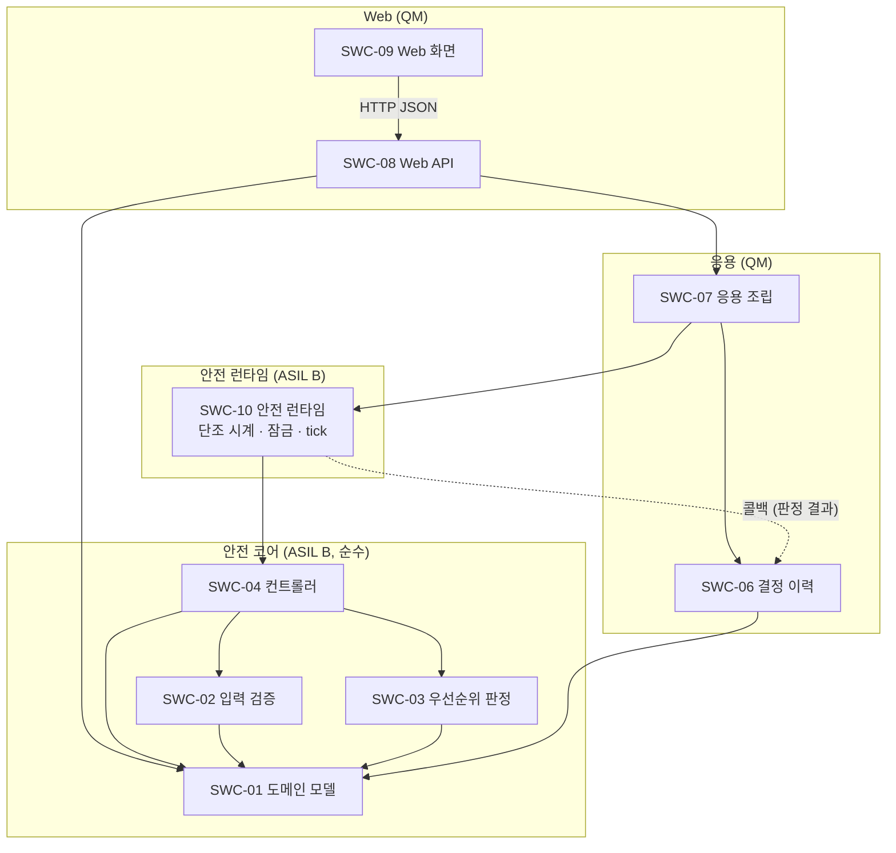
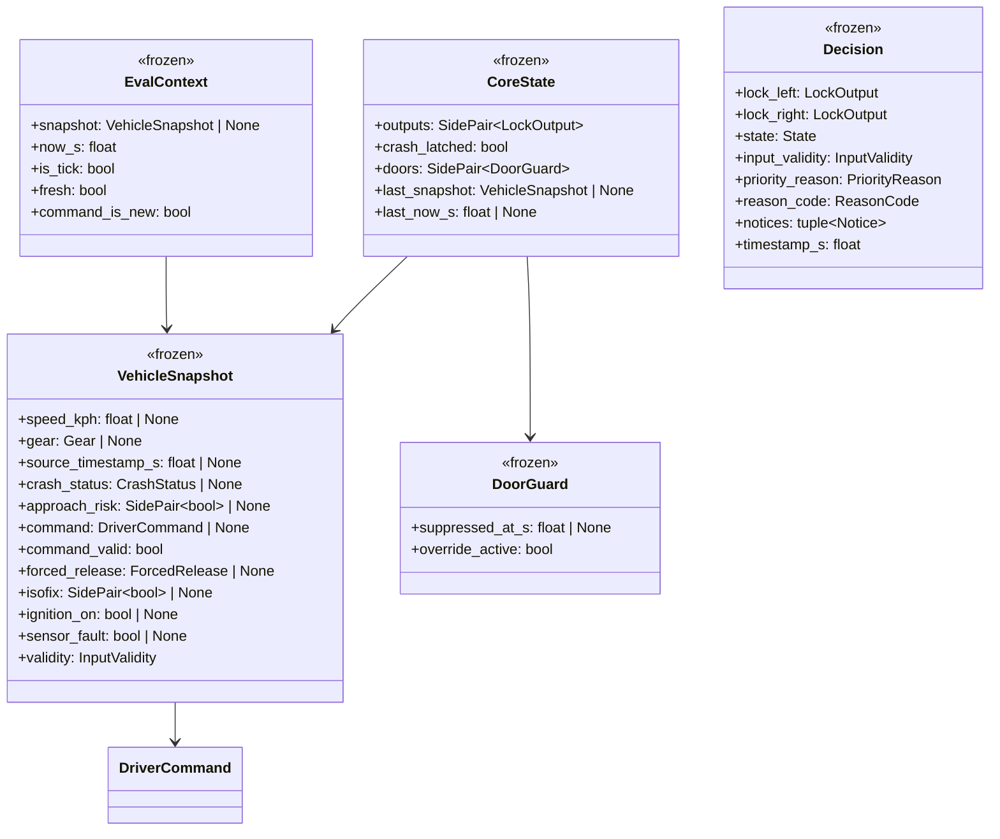
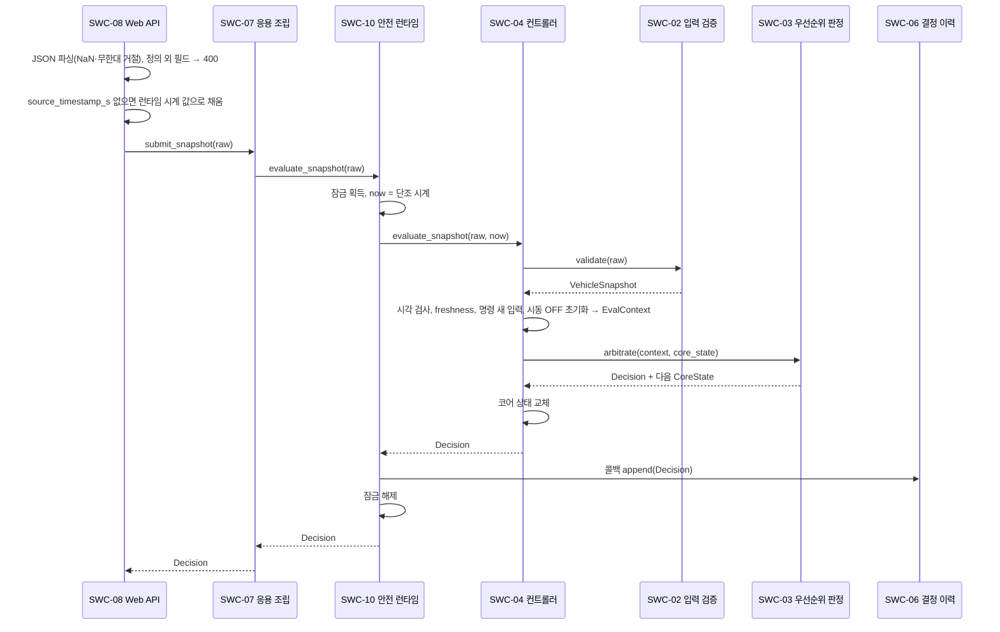
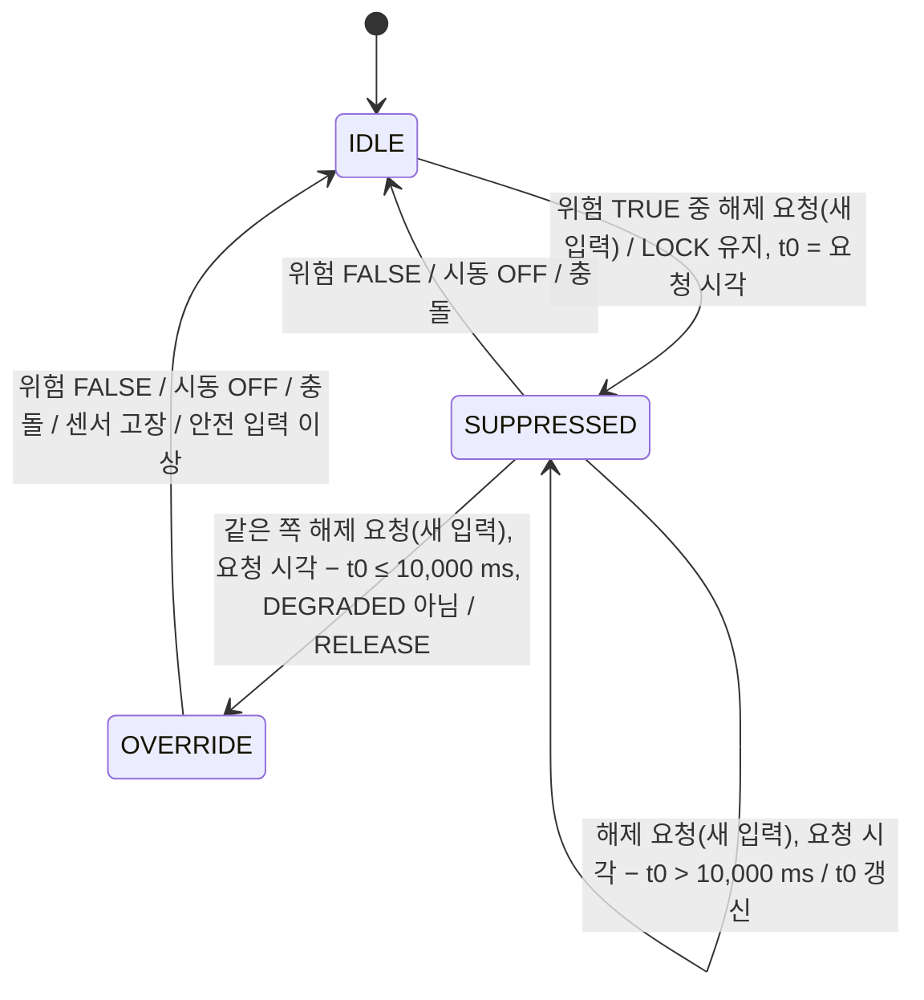

# SW 아키텍처 설계서 (SWAD)

| 항목 | 내용 |
|---|---|
| 문서 ID | SWAD-ECL-001 |
| 개정 | 0.2 (독립 검토 RV-03 결과 반영) |
| 입력 | SWRS-ECL-001 (BL-SWR-1.0) |
| 목표 베이스라인 | BL-SWA-1.0 (게이트 G2) |
| 상태 | 초안 — 사용자 승인 대기 |
| 작성일 | 2026-11-26 |

## 1. 개요

### 1.1 목적
SWRS의 SW 요구사항 26건을 구현할 SW 컴포넌트, 컴포넌트 간 인터페이스와 데이터, 동적 동작, ASIL B와 QM 요소 간 간섭 방지 방법을 정의한다.

### 1.2 설계 원칙
ISO 26262-6 아키텍처 설계 원칙(계층 구조, 크기·복잡도 제한, 인터페이스 최소화, 높은 응집도·낮은 결합도, 적절한 스케줄링)을 다음과 같이 적용한다.

| 원칙 | 적용 |
|---|---|
| 계층 구조 | 안전 코어(ASIL B, 순수 코드) ← 안전 런타임(ASIL B, 시계·스레드) ← 응용 조립(QM) ← Web(QM). 의존은 바깥에서 안쪽으로만 |
| 순수 판정 | 입력 검증과 우선순위 판정은 입출력·시계·전역 상태가 없는 순수 함수 (결정론 SWR-016, 시험성) |
| 상태 집중 | 코어의 가변 상태는 컨트롤러 한 곳에만 둔다 |
| 불변 데이터 | 컴포넌트 사이에 오가는 데이터는 불변 객체(frozen dataclass, tuple) |
| 인터페이스 최소화 | 코어 공개 진입점은 `evaluate_snapshot`, `evaluate_tick`, `last_decision` 3개 |
| 복잡도 제한 | 함수 순환 복잡도 10 이하, 순수 코드 50줄 이하 (CLAUDE.md) |
| 직렬 실행 | 평가는 안전 런타임의 잠금 아래에서 한 번에 하나씩 실행 |

## 2. 정적 구조

### 2.1 컴포넌트

| ID | 컴포넌트 | 모듈 | ASIL | 책임 |
|---|---|---|---|---|
| SWC-01 | 도메인 모델 | `child_lock/core/model.py` | B | 열거형(출력, 상태, 유효성, `priority_reason`, `reason_code`, 알림), 불변 데이터 타입(스냅샷, 명령, 판정 입력, 판정 결과, 코어 상태) |
| SWC-02 | 입력 검증 | `child_lock/core/validation.py` | B | 원시 입력(dict) → 검증된 스냅샷 + 키별 유효성. 형식·범위·enum·NaN/무한대 검사 |
| SWC-03 | 우선순위 판정 | `child_lock/core/arbitration.py` | B | 순수 함수. 판정 입력(`EvalContext`) + 코어 상태 → 쪽별 출력, `priority_reason`, `reason_code`, 알림, 상태, 다음 코어 상태 |
| SWC-04 | 컨트롤러 | `child_lock/core/controller.py` | B | 코어 상태 보관과 평가 순서 실행(검증 → 시각 검사·freshness → 명령 새 입력 판정 → 시동 OFF 초기화 → 판정 → 상태 교체) |
| SWC-10 | 안전 런타임 | `child_lock/runtime/runtime.py` | B | 단조 시계, 평가 직렬화 잠금, 50 ms tick 스레드, 판정 결과 전달(콜백). 시계·스레드를 쓰는 유일한 ASIL B 요소 |
| SWC-06 | 결정 이력 | `child_lock/app/event_log.py` | QM | 최근 100건 메모리 링 버퍼, `event_id` 부여, SWR-011 허용 필드만 보관 |
| SWC-07 | 응용 조립 | `child_lock/app/service.py` | QM | 런타임·이력 생성과 연결, Web에 제공하는 파사드(`submit_snapshot`, `status`, `events`) |
| SWC-08 | Web API | `child_lock/web/server.py` | QM | `http.server` 기반 HTTP 처리, 요청 스키마·필드 제한(SWR-026), JSON 직렬화, 400/500 응답 |
| SWC-09 | Web 화면 | `child_lock/web/static/index.html` | QM | 시뮬레이터 화면(입력 설정, 상태·이력 표시). API만 호출 |

> SWC-05(시계)는 개정 0.1의 ID이다. 0.2에서 시계를 SWC-10으로 옮겼다. 시험용 수동 시계는 시험 코드(`tests/`)에 둔다.

점선 콜백은 런타임이 정의한 콜백 형식(`Callable[[Decision], None]`)으로 호출하며, 런타임은 이력 모듈을 import하지 않는다.

### 2.2 의존 규칙

| 규칙 | 내용 |
|---|---|
| DEP-01 | `child_lock.core`는 `child_lock.core` 밖의 패키지 모듈을 import하지 않는다 |
| DEP-02 | `child_lock.core`는 표준 라이브러리 중 **허용 목록만** import한다: `__future__`, `abc`, `collections.abc`, `dataclasses`, `enum`, `functools`, `math`, `typing`. 또한 내장 함수 `open`, `print`, `input`, `eval`, `exec`, `compile`, `__import__`를 호출하지 않는다 |
| DEP-03 | `child_lock.runtime`은 `child_lock.core`와 표준 라이브러리만 import한다(`app`, `web` 금지) |
| DEP-04 | `child_lock.app`은 `child_lock.web`을 import하지 않는다 |
| DEP-05 | `child_lock.web`은 `child_lock.app`과 `child_lock.core.model`만 import한다(컨트롤러·런타임 직접 호출 금지 → 잠금 우회 방지) |
| DEP-06 | 다른 모듈의 비공개 속성(`_` 접두사)에 접근하지 않는다(Ruff `SLF001`) |
| DEP-07 | 런타임 의존성은 표준 라이브러리뿐이다(SWR-024, `dependencies = []`) |

모든 규칙은 정적 분석 계획 SA-05(아키텍처 시험)와 SA-01(Ruff)로 확인한다.

### 2.3 주요 데이터 (SWC-01)

**유효성 표현** (`InputValidity`, 값 `VALID` / `INVALID` / `STALE`):

| 키 | 대상 필드 | 무효 시 영향 |
|---|---|---|
| `IF-001` | `vehicle_speed_kph`, `gear` | 자동 잠금(순위 8), 운전자 해제 조건 (a) 비활성. DEGRADED 아님 |
| `IF-002` | `crash_status` | 충돌 규칙 비활성, DEGRADED |
| `IF-003` | 좌·우 접근위험 | 접근위험 규칙 비활성, DEGRADED |
| `IF-004` | 운전자 명령 | 명령 거절(`COMMAND_REJECTED`). DEGRADED 아님 |
| `IF-007` | 화재·과온·성인 | 강제 해제 규칙 비활성. DEGRADED 아님 |
| `IF-008` | 좌·우 ISOFIX | ISOFIX 규칙·운전자 해제 조건 (c) 비활성. DEGRADED 아님 |
| `IF-009` | 시동, 센서 고장 | 시동·센서 고장 규칙 비활성, DEGRADED |
| `FRESHNESS` | `source_timestamp_s` + 평가 시각 | `VALID` 또는 `STALE`. STALE이면 DEGRADED |

`source_timestamp_s`는 OEM 인터페이스상 IF-001에 속하지만 유효성은 `FRESHNESS` 키로 따로 판정한다. 따라서 차속·기어만 무효인 경우는 DEGRADED가 아니다(DEF-08). `source_timestamp_s`가 누락·형식 오류·미래 시각이면 `FRESHNESS = STALE`이다(SWRS 3.6).

무효 키에 속한 필드는 `None`으로 둔다. 판정 함수는 무효 값을 실수로 쓸 수 없다(DEF-07).

## 3. 동적 동작

### 3.1 스냅샷 평가

### 3.2 tick 평가와 입력 중단 감시 (SWR-022)
- SWC-10의 tick 스레드가 50 ms마다 `evaluate_tick(now)`를 호출한다. `GET /api/status` 처리 때도 SWC-07을 통해 1회 호출한다.
- 컨트롤러는 `CoreState.last_snapshot`을 다시 판정한다. freshness는 `round((now − last_snapshot.source_timestamp_s) × 1000) > 200`이면 STALE이다(DEF-04).
- tick에서는 운전자 명령을 적용하지 않는다(`command_is_new = False`). 명령 관련 알림(`COMMAND_REJECTED`, `DRIVER_UNLOCK_REJECTED`, `UNLOCK_SUPPRESSED`)은 내지 않는다. 입력 상태 알림(`CRASH_PENDING`)은 마지막 스냅샷 기준으로 다시 낸다.
- 첫 스냅샷 전 tick은 DEF-06에 따라 출력 좌·우 `RELEASE`, 상태 `OFF`, `priority_reason = NONE`, `reason_code = NO_CHANGE`, 모든 유효성 키 `INVALID`, 감시 없음으로 결과를 낸다.
- tick 결과도 결정 이력에 기록한다(SWR-010). 이 때문에 이력 100건이 약 5초 분량의 tick으로 채워지는 문제는 변경 요청 CR-01로 다룬다(8장).

### 3.3 평가 순서 (컨트롤러 내부)
1. 입력 검증(스냅샷 평가) 또는 `last_snapshot` 재사용(tick 평가)
2. 시각 검사: `now < last_now_s`(시각 역행)이면 이번 평가의 `FRESHNESS = STALE`
3. freshness 판정(3.2 식). `source_timestamp_s`가 `now`보다 미래이면 STALE
4. 운전자 명령 새 입력 판정: 명령이 유효하고 직전 스냅샷의 명령과 다르면(직전에 명령이 없었던 경우 포함) 새 입력(DEF-09)
5. 시동 OFF(IF-009 유효, `ignition_on = FALSE`)면 충돌 래치·override·억제 시각 초기화(SWR-020)
6. 우선순위 판정(SWC-03): 순위 1→9 순서로 쪽별 결정, 알림 수집
7. 상태 결정(DEF-10), 코어 상태를 새 불변 객체로 한 번에 교체

### 3.4 쪽별 접근위험 가드 상태 (SWR-006)

요청 시각은 해당 스냅샷의 `source_timestamp_s`이다. FRESHNESS가 STALE이면 DEGRADED이므로 override 전이는 일어나지 않는다.

### 3.5 시스템 상태 (DEF-10)
상태는 저장하지 않고 매 평가마다 계산한다: `EMERGENCY` → `FAULT` → `DEGRADED` → `OVERRIDE` → `OFF` → `NORMAL` 순서로 처음 맞는 값. 저장하는 것은 원인(래치, override, 직전 출력)뿐이므로 상태와 원인이 어긋날 수 없다.

## 4. 인터페이스

### 4.1 코어 공개 인터페이스 (SWC-04)

| 함수 | 입력 | 출력 | 관련 SWR |
|---|---|---|---|
| `ChildLockController.evaluate_snapshot(raw: Mapping[str, object], now_s: float) -> Decision` | 원시 스냅샷, 평가 시각 | 판정 결과 | SWR-001~009, 013, 017~021 |
| `ChildLockController.evaluate_tick(now_s: float) -> Decision` | 평가 시각 | 판정 결과 | SWR-022 |
| `ChildLockController.last_decision -> Decision` | – | 마지막 판정 결과 | SWR-014 |

### 4.2 안전 런타임 인터페이스 (SWC-10)

| 함수 | 설명 |
|---|---|
| `SafetyRuntime(controller, clock, on_decision)` | `clock`은 `Callable[[], float]`(기본: 시작 시점 기준 `time.monotonic()` 초), `on_decision`은 판정 결과 콜백 |
| `evaluate_snapshot(raw) -> Decision` / `tick() -> Decision` | 잠금 아래에서 시계를 읽고 컨트롤러 호출, 콜백 호출 |
| `now() -> float` | 런타임 시계 값(Web의 `source_timestamp_s` 채움용) |
| `start()` / `stop()` | 50 ms tick 스레드 시작·정지. tick 중 예외는 잡아서 기록하고 루프를 계속한다 |

### 4.3 HTTP 인터페이스 (SWC-08)

| 메서드·경로 | 요청 | 응답 | 오류 |
|---|---|---|---|
| `GET /` | – | 시뮬레이터 화면 HTML | – |
| `GET /api/status` | – | `Decision` JSON (tick 1회 후) | 직렬화 실패 500 |
| `GET /api/events` | – | 이벤트 배열(오래된 순, 최대 100) | 직렬화 실패 500 |
| `POST /api/snapshot` | 스냅샷 JSON (4.4) | 평가 후 `Decision` JSON | JSON 아님·NaN/무한대·최상위가 객체 아님·정의 외 필드 400, 직렬화 실패 500 |

**`Decision` JSON**: `lock_left`, `lock_right`, `state`, `input_validity`(2.3의 8개 키 → `VALID`/`INVALID`/`STALE`), `priority_reason`, `reason_code`, `notices`, `timestamp_s`.

**이벤트 JSON** (SWR-011 허용 필드와 정확히 같음): `event_id`, `timestamp_s`, `lock_left`, `lock_right`, `state`, `priority_reason`, `reason_code`, `notices`. `input_validity`는 넣지 않는다.

### 4.4 스냅샷 요청 스키마

최상위는 JSON 객체이며 아래 키만 허용한다(SWR-026). 키가 없으면 400이 아니라 해당 그룹 `INVALID`로 처리한다(SWR-013 누락 검사). 값의 형식·범위 검사는 코어(SWC-02)가 한다.

| 키 | JSON 형식 | 그룹 |
|---|---|---|
| `vehicle_speed_kph` | number | IF-001 |
| `gear` | string | IF-001 |
| `source_timestamp_s` | number (생략 시 서버가 런타임 시계 값으로 채움) | FRESHNESS |
| `crash_status` | string | IF-002 |
| `rear_left_approach_risk`, `rear_right_approach_risk` | boolean | IF-003 |
| `command` | object `{side, action, source}` 또는 생략·null(명령 없음). 객체 안에도 이 세 키만 허용 | IF-004 |
| `fire_detected`, `overtemperature_detected`, `adult_present` | boolean | IF-007 |
| `isofix_left`, `isofix_right` | boolean | IF-008 |
| `ignition_on`, `sensor_fault` | boolean | IF-009 |

**시간 기준**: 모든 시각은 런타임 시계(서버 시작 시점 기준 단조 증가 초)이다. 클라이언트가 `source_timestamp_s`를 직접 넣을 때는 `/api/status`의 `timestamp_s`를 기준으로 쓴다. PC/SIL에서 차량 시각을 시뮬레이션하기 위한 정의이다.

## 5. 요구사항 할당

| SWR | ASIL | 컴포넌트 |
|---|---|---|
| SWR-001 | QM | SWC-03, SWC-04(새 입력 판정) |
| SWR-002 | QM | SWC-02, SWC-03(알림) |
| SWR-003 | QM | SWC-03 |
| SWR-004 | QM | SWC-03 |
| SWR-005 | B | SWC-03 |
| SWR-006 | B | SWC-03, SWC-04 |
| SWR-007 | B | SWC-02, SWC-03, SWC-04 |
| SWR-008 | B | SWC-03 |
| SWR-009 | B | SWC-03 |
| SWR-010 | QM | SWC-06, SWC-10(콜백) |
| SWR-011 | QM | SWC-06, SWC-08 |
| SWR-012 | QM | SWC-06 |
| SWR-013 | B | SWC-02, SWC-04 |
| SWR-014 | QM | SWC-01, SWC-07, SWC-08, SWC-10(조회 시 tick) |
| SWR-015 | QM | SWC-08 |
| SWR-016 | QM | SWC-02, SWC-03, SWC-04 (시각은 인자로만 받음) |
| SWR-017 | QM | SWC-03 |
| SWR-018 | QM | SWC-03 |
| SWR-019 | B | SWC-03 |
| SWR-020 | QM | SWC-03, SWC-04 |
| SWR-021 | B | SWC-03 |
| SWR-022 | B | SWC-04, SWC-10 |
| SWR-023 | B | SWC-02, SWC-03, SWC-04 |
| SWR-024 | QM | 전체 |
| SWR-025 | QM | SWC-09, SWC-08 |
| SWR-026 | QM | SWC-08 |

모든 SWR(26/26)이 할당되었다. ASIL B SWR은 모두 ASIL B 컴포넌트(SWC-01~04, SWC-10)에 할당되었다.

## 6. 안전 설계

### 6.1 ASIL B·QM 혼재와 간섭 방지 (ISO 26262-6 7.4, 부속서 D)

한 프로세스 안에서 ASIL B(코어·런타임)와 QM(이력·응용 조립·Web)이 함께 동작한다. 간섭 유형별 대책은 다음과 같다.

| 간섭 유형 | 위험 | 대책 |
|---|---|---|
| 데이터(메모리) | QM이 코어 상태를 변경 | 코어 상태는 컨트롤러 비공개 속성에만 있고 불변 객체로 교체. 외부로 나가는 `Decision`도 불변. 의존 규칙 DEP-01·03·05, 비공개 접근 금지 DEP-06을 정적 분석으로 강제 |
| 데이터(입력) | Web이 잘못된 입력 전달 | 코어가 모든 입력을 다시 검증(SWC-02). Web의 필드 제한은 개인정보 목적이며 안전 검증을 대신하지 않음 |
| 시간(처리) | QM 처리가 평가를 지연 | 평가는 코어 안에서 10 ms 이하(SWR-023). 잠금 안의 QM 작업은 이력 콜백 1건(`deque.append`, 상수 시간)뿐이며 SWR-023 측정에 포함한다 |
| 시간(스케줄) | HTTP 스레드가 tick을 지연(GIL, 잠금 경쟁) | HTTP 처리 중 잠금 보유는 평가 1회 분량뿐. 상태 조회 때도 tick 수행. 통합 시험에서 tick 간격 최대값을 측정(목표 ≤ 100 ms → 입력 중단 후 300 ms 이내 DEGRADED) |
| 실행 순서 | 스냅샷과 tick 동시 평가 | 안전 런타임(ASIL B)의 잠금으로 직렬 실행. Web은 런타임을 직접 호출할 수 없음(DEP-05) |
| 시계 | 시각 역행·점프 | 단조 시계(`time.monotonic`) 사용. 코어는 시각 역행을 STALE로 처리(3.3 2단계) |
| 예외 | QM 콜백이나 판정 중 예외 | 코어 상태 교체는 판정이 끝난 뒤 한 번에. 판정 중 예외 시 상태·출력 변경 없음, HTTP 500. 콜백 예외는 런타임이 잡아 기록하고 평가 결과는 그대로 반환. tick 스레드는 예외를 잡고 계속 실행 |

### 6.2 안전 분석 (ASIL B 컴포넌트 고장 모드)

| 컴포넌트 | 고장 모드 | 영향 | 대책 | 관련 SWR |
|---|---|---|---|---|
| SWC-02 | 무효 값을 유효로 판정 | 잘못된 입력으로 판정 | 키별 경계값 단위 시험, 무효 필드 `None` | SWR-013 |
| SWC-02 | 유효 CONFIRMED를 무효로 판정 | 충돌 해제 실패 | IF-002를 다른 키와 독립 검증, freshness와 무관(SWR-007) | SWR-007 |
| SWC-02 | 유효 접근위험 TRUE·`sensor_fault` TRUE를 무효로 판정 | 접근위험 잠금 실패, 센서 고장 미검출 | 키별 독립 검증. 무효 판정 시에도 DEGRADED로 직전 출력 유지(안전 방향) | SWR-005, 013, 021 |
| SWC-03 | 우선순위 순서 오류 | QM 규칙이 ASIL B 규칙을 무효화 | 판정 순서를 한 곳에 표로 정의, 순위 쌍 조합 시험 | SWR-019 |
| SWC-03 | 좌·우 혼동 | 다른 쪽 문 해제 | 쪽별 처리를 같은 함수에 쪽 인자로 호출, 비대칭 입력 시험 | SWR-009 |
| SWC-03 | override 종료 누락, DEGRADED 중 override 허용 | 위험 중 해제 지속 | 3.4 상태 전이 모든 경로 시험 | SWR-006 |
| SWC-04 | 명령 새 입력 판정 오류(같은 명령을 새 입력으로 봄) | 의도치 않은 override → 위험 중 해제 (가장 위험한 경로) | 엣지 판정 단위 시험(연속 동일 명령, 명령 없음 후 재입력, tick 사이) | SWR-006 |
| SWC-04 | 래치·override 상태 유실 | 충돌 해제 유지 실패 | 불변 상태 일괄 교체, 상태 전이 시험 | SWR-007 |
| SWC-04 | freshness 계산 오류, 시각 역행 미처리 | 지연 입력 미검출 | ms 정수 비교, 200/201 ms 경계 시험, 역행 시험 | SWR-013, 022 |
| SWC-10 | tick 스레드 정지·지연 | 입력 중단 미검출 | 예외 시 루프 유지, 상태 조회 시 tick, tick 간격 측정 시험 | SWR-022 |
| SWC-10 | 잠금 누락 | 동시 평가로 상태 손상 | 모든 평가 경로가 잠금을 거치는지 시험, Web의 직접 호출 금지(DEP-05) | SWR-019 |

### 6.3 PC/SIL 범위의 한계와 남는 위험
- Python 실행 환경은 실시간 OS가 아니므로 tick 주기·처리 시간은 PC 측정값으로만 확인한다. 양산 ECU의 실행 시간 보장은 범위 밖이다(OEM 3장).
- 메모리 보호(MPU) 같은 HW 분리 수단이 없다. Python에서는 QM 코드가 런타임에 비공개 속성 접근이나 monkeypatch를 할 수 있다. 정적 분석(DEP-05·06)과 코드 리뷰로만 막는다. 코드 리뷰 체크리스트: QM 모듈에서 `core`/`runtime` 내부 접근, `setattr`, monkeypatch 사용 여부.

## 7. 설계 대안 검토

| 결정 | 선택 | 대안 | 선택 이유 |
|---|---|---|---|
| 판정 구조 | 순위 표 순서대로 평가하는 순수 함수 | 상태 기계 하나로 전체 표현 | 규칙 9개 × 좌우 조합을 상태로 표현하면 상태 폭발. 순수 함수가 시험·결정론에 유리 |
| 상태 저장 | 원인만 저장, 상태는 계산 | 상태 변수 직접 저장 | 상태와 원인 불일치 방지 |
| 시계·스레드 위치 | 별도 ASIL B 안전 런타임(SWC-10) | 코어 내부 / QM 서비스 | 코어는 순수 코드로 유지(DEP-02)하면서, 안전 메커니즘(tick·잠금·시계)은 ASIL B로 개발 |
| 이력 연결 | 런타임이 정의한 콜백 | 런타임이 이력 모듈 import | ASIL B가 QM에 의존하지 않음 |
| Web | 표준 라이브러리 `http.server` | FastAPI 등 | 런타임 의존성 0 (D-02, SWR-024) |
| 무효 값 표현 | 무효 필드 `None` + 키별 유효성 | 예외 발생 | 무효 그룹이 있어도 다른 규칙은 계속 평가(DEF-07) |

## 8. 변경 요청

| ID | 대상 | 내용 | 상태 |
|---|---|---|---|
| CR-01 | SWRS SWR-010 | tick 결과까지 모두 기록하면 50 ms마다 이벤트가 생겨 최근 100건이 약 5초 분량이 된다. 이력이 결정 추적에 쓸모가 없어진다. 제안: "스냅샷 평가 결과는 모두 기록하고, tick 결과는 출력·상태·`reason_code` 중 하나가 직전 판정과 다를 때만 기록한다." | 사용자 결정 대기. 결정 전까지 SWRS 원문(모두 기록)을 따른다 |

## 9. 개정 이력

| 개정 | 일자 | 내용 |
|---|---|---|
| 0.1 | 2026-11-26 | 최초 작성 |
| 0.2 | 2026-11-26 | 독립 검토 RV-03 반영: 안전 런타임 SWC-10(ASIL B) 신설, FRESHNESS 유효성 키 분리, `EvalContext`·`last_snapshot` 추가, tick 규칙·첫 스냅샷 전 동작, 의존 규칙 허용 목록화와 DEP-05·06 추가, 이벤트·요청 스키마와 시간 기준, 시각 역행 처리, 고장 모드 추가, CR-01 |
